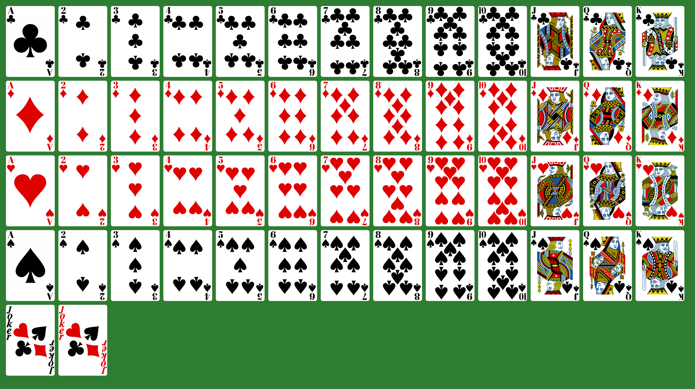
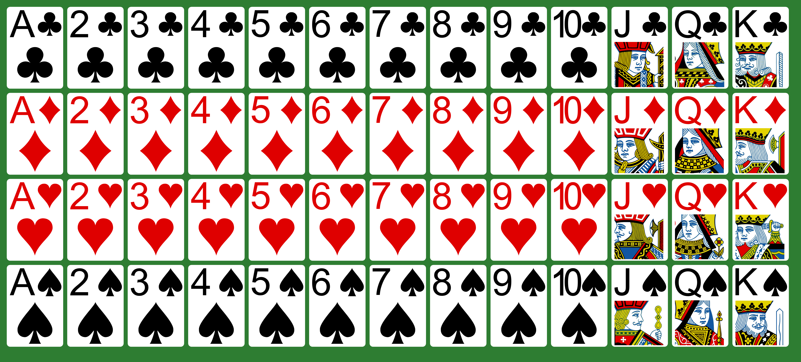

# SVG Playing Cards

A full 54-card deck (52 cards + 2 jokers) as standalone SVGs, based on Byron
Knoll's public-domain [Vector Playing Cards 1.3](https://code.google.com/archive/p/vector-playing-cards/),
restyled for use in games and apps.



## What's here

| Path | Contents |
|---|---|
| `*.svg` | The main deck, with ranks in **Abril Fatface** |
| `arial/*.svg` | The same deck with ranks in **Arial** (see [Licensing](#licensing)) |
| `small/*.svg`, `arial/small/*.svg` | The [small-size deck](#small-size-deck) in each font, for cards shown small |
| `all_cards.png`, `arial/all_cards.png`, `small/all_cards.png`, `arial/small/all_cards.png` | Contact sheets of each deck |
| `all_cards_baseline.png` | The deck before the rank font change, for comparison |
| `tools/` | Scripts that generate the ranks, the small-size deck and the contact sheets |

Files are named `<rank>_of_<suit>.svg`, where rank is `ace`, `2`–`10`, `jack`,
`queen` or `king` and suit is `clubs`, `diamonds`, `hearts` or `spades`, plus
`black_joker.svg` and `red_joker.svg`. Every card uses the same
`viewBox="0 0 167.0869141 242.6669922"`.

## Changes from the original

- Uses the original set's alternate (`*2.svg`) designs for the ace of spades
  and all jacks, queens and kings.
- No black rounded-rect border around the card, or around the face-card art.
- The aces' large suit symbols are solid black or red, with no gradient shine.
- Rank indices are vector outlines, not `<text>`, so they render the same
  everywhere without any font installed. They're top-aligned at the same
  margin on every card and centred over the corner suit.
  - A, 2–10 and J have a cap height of 22.9 units; K and Q have 20.6, the
    sizes the original deck used. The 10 is narrowed to fit beside its pips.
- The queens' small corner suits are moved down slightly to clear the Q's tail.

The jokers are unchanged apart from the border. Their "Joker" lettering is
still `<text>` that relies on locally installed fonts.

## Small-size deck

At phone-game sizes (around 50 points wide) the main deck's corner indices are
too small to read at a glance. The small-size deck has 52 cards (no jokers)
laid out for that:

- A big rank in the top-left corner, a third of the card tall, with the suit
  beside it. The 10's digits are set closer together, and the slight
  narrowing it still needs is made up with a thin outline so its strokes
  match the other ranks.
- Aces and number cards have one big pip below. Every suit's pip is the plain
  one from its 2, so the ace of spades isn't ornate here.
- Jacks, queens and kings show the top half of their main-deck art, cropped
  just right of the art's own suit symbol and cut off by the bottom of the
  card.



The cards are built from the main deck, so they share its artwork. A face
card keeps only the parts of the art that show: shapes wholly outside the
crop are left out and coordinates are rounded to a tenth of a unit, which
takes a face card from about 600 KB to 150–230 KB without a visible
change. Each deck is about 2.5 MB. The parts are placed with plain groups,
transforms and clip paths rather than `<symbol>` and `<use>`, so Apple's
CoreSVG (asset catalogs, `UIImage`, `NSImage`) draws them the same as a
browser.

## Using the cards

Reference them straight from GitHub through jsDelivr:

```html

```

Or vendor them into your project with a git submodule:

```sh
git submodule add https://github.com/seeligd/svg-playing-cards.git assets/cards
```

## Regenerating

```sh
pip install fonttools svgpathtools
python3 tools/set_ranks.py                          # main deck (Abril Fatface)
python3 tools/set_ranks.py --font arial --out arial # Arial deck (macOS)
python3 tools/make_small.py                         # small-size deck (Abril Fatface)
python3 tools/make_small.py --font arial --out arial/small
tools/render_all.sh                                 # all_cards.png (needs Google Chrome)
tools/render_all.sh arial/all_cards.png arial
tools/render_all.sh small/all_cards.png small
tools/render_all.sh arial/small/all_cards.png arial/small
```

Sizes, margins and per-rank limits are constants at the top of
`tools/set_ranks.py` and `tools/make_small.py`. The Arial decks read Arial
from the macOS system fonts. Run `make_small.py` after `set_ranks.py`, since
it takes its artwork from the main deck.

## Licensing

- **Card artwork:** Byron Knoll released Vector Playing Cards into the public
  domain ("attribution is appreciated but not required"). Thanks, Byron!
- **Modifications and `tools/` scripts:** MIT. See [LICENSE](LICENSE) and
  [NOTICE](NOTICE).
- **Abril Fatface** (by TypeTogether): SIL Open Font License 1.1. See
  [tools/fonts/OFL.txt](tools/fonts/OFL.txt). The main deck's rank outlines are
  derived from it.
- **Arial:** the rank outlines in `arial/` are derived from Arial, a
  commercial Monotype font. They aren't covered by the MIT license or the
  public-domain dedication. If that's a concern for your project, use the main
  (Abril) deck.
